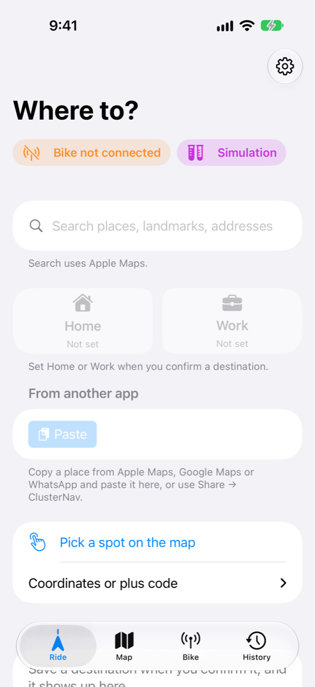
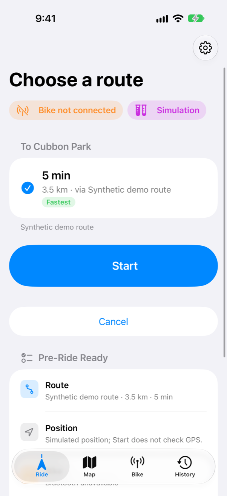
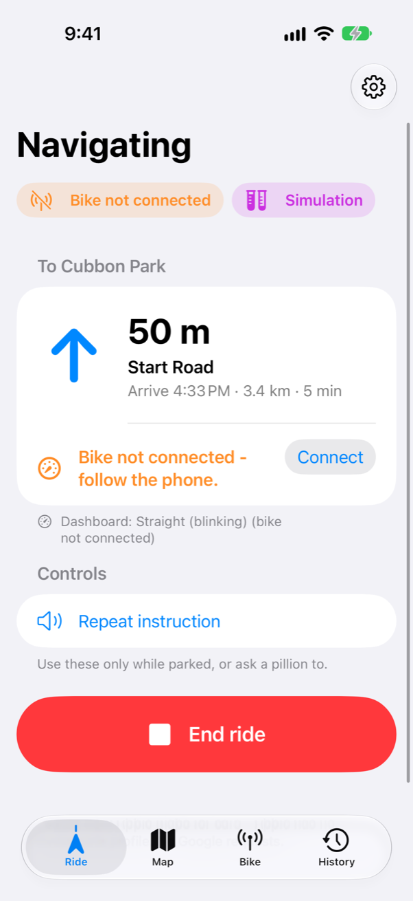
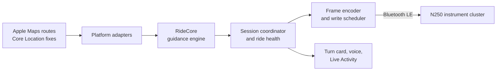

<div align="center">

# ClusterNav

**Turn-by-turn navigation on the instrument cluster your motorcycle already has.**

An unofficial iPhone app that plans a route with Apple Maps, tracks the ride with its own guidance engine, and sends turn arrows, distance and arrival time to the 2026 Bajaj Pulsar N250's dashboard over Bluetooth Low Energy.


<br>

&nbsp;&nbsp;
&nbsp;&nbsp;


<sub>Simulator screenshots in simulation mode, with no bike connected.</sub>

</div>

---

> [!WARNING]
> **Development status.** This is a development build, not a road-validated release. Parked bench checks and the owner's ride feedback have shaped roundabout exits, spoken directions and dashboard updates, but they do not establish end-to-end navigation reliability. Don't rely on this build as your sole navigation aid. The [support matrix](docs/support-matrix.md) lists the evidence and limits feature by feature.

ClusterNav is not affiliated with or endorsed by Bajaj Auto or Apple.

## Contents

- [Features](#features)
- [How it works](#how-it-works)
- [Try it in the simulator](#try-it-in-the-simulator)
- [Install on an iPhone](#install-on-an-iphone)
- [Using the app](#using-the-app)
- [Project layout](#project-layout)
- [Testing](#testing)
- [Current limits](#current-limits)
- [Documentation](#documentation)
- [Acknowledgements and licence](#acknowledgements-and-licence)

## Features

| | |
| --- | --- |
| **Dashboard guidance** | Turn arrows, distance to the turn, remaining distance and arrival time on the N250's existing cluster, sent as 48-byte frames over BLE. |
| **On-phone guidance engine** | Snaps GPS to the route, tracks progress, detects off-route riding, reroutes, and handles roundabout exits and arrival. |
| **Stale data is never shown as a direction** | One ride-health evaluator decides whether any surface may show a turn. A position older than 5 s or worse than 50 m pauses the arrows on the phone, the dashboard and the Lock Screen. |
| **Route choice** | Up to three Apple Maps alternatives from one request, selectable in a list or by tapping the line on the map, with avoid-tolls and avoid-highways options. |
| **Spoken directions** | Detailed or concise prompts through the helmet, earphones or speaker, with repeat, and a hold when a headset disconnects. |
| **Destinations from anywhere** | Search, Home and Work shortcuts, favourites and recents, a map long-press, coordinates or plus codes, pasted map links, the share extension, and Siri previews for Home and Work. |
| **One stop on the way** | Leg one ends at the stop; continuing calculates a fresh route from where the rider is. |
| **Live Activity** | The current turn on the Lock Screen and Dynamic Island on supported devices. |
| **Private by default** | Ride history, GPS recaps with GPX export, and ride recovery are each opt-in, stored on the phone only, and excluded from backups. |
| **Parked bench tools** | A simulation mode, a step-by-step bike compatibility check, a manual checklist and a Bluetooth console for inspecting what the cluster actually does. |

## How it works



| Layer | Design |
| --- | --- |
| [SwiftUI app and platform adapters](ClusterNav/) | MapKit supplies route candidates and Core Location supplies position samples. The adapters turn those results into plain Swift values that can also come from test doubles. A new route is prepared before it replaces the active one. |
| [RideCore](Packages/RideCore/) | A standalone Swift package snaps position to route geometry, tracks progress, detects off-route movement, and produces typed navigation snapshots. An injected clock supports repeatable fixture replay and stale-state tests. |
| [Cluster protocol](docs/protocol/) | RideCore encodes guidance and status frames and schedules writes. The CoreBluetooth adapter handles the physical link; the parked console and manual checklist let a tester compare write outcomes with what the cluster actually shows. |
| [Share extension](ClusterNavShare/) and [Live Activity](ClusterNavWidgets/) | The share extension imports destinations. The widget extension presents current guidance on supported Lock Screen and Dynamic Island surfaces. |

Live routing uses **MapKit's car profile**; MapKit has no motorcycle profile. The optional Google adapter is excluded from the default build; see [feasibility](docs/feasibility.md) and the [cost model](docs/cost-model.md).

## Try it in the simulator

Simulation needs no bike, API key or live route request. It demonstrates the app flow, not physical dashboard behaviour.

**Requirements:** macOS with Xcode 26 or later, an installed iOS simulator runtime, and [XcodeGen](https://github.com/yonaskolb/XcodeGen).

```sh
brew install xcodegen
xcodegen generate
open ClusterNav.xcodeproj
```

1. Select the **ClusterNav** scheme and an iPhone simulator, then run the app.
2. Open **Ride settings → Advanced** and enable **Simulation mode**.
3. On the Ride tab, expand **Coordinates or plus code**, enter `12.9716, 77.5946`, confirm the destination, then tap **Start**.
4. Watch the turn card and distance update on the synthetic route. Tap **End ride** to return to the picker.

**Show Diagnostics tab**, in the same settings section, reveals the bench tools.

## Install on an iPhone

```sh
cp Config/Local.example.xcconfig Config/Local.xcconfig
```

Set `N250_DEVELOPMENT_TEAM` to your Xcode team ID and `N250_BUNDLE_ID` to a unique bundle identifier in that file, then run `xcodegen generate`, open the project, choose your iPhone and run. `Config/Local.xcconfig` is ignored by version control; never commit signing values or API keys.

The [setup guide](docs/setup.md) covers Xcode first-launch setup, Developer Mode, trusting the certificate, and the 7-day expiry of free Personal Team installs. For the first pairing, close the official Bajaj app, disconnect other phones, and use **Bike → Scan for bike** while parked.

## Using the app

- **Pre-Ride Ready.** While parked, check **Route**, **Position**, **Bike** and **Helmet audio** in the route preview. **Start** checks your current position in live mode. Bike connection and spoken directions do not block starting.
- **Route alternatives.** In a live preview, tap **See routes on the map**. Tap a route line or its time-and-distance label to select it, then return to **Ride** and tap **Start**.
- **Siri Home or Work preview.** Save **Home** or **Work** under **Ride settings → Places**, then try "Preview my route home in ClusterNav". Siri opens the app for a preview; tap **Start** separately. Siri invocation has not been validated on a physical iPhone.
- **History.** Turn on **Keep ride history** in the History tab to keep the date, ride time and an estimated distance of each ride for 30 days. No positions are stored.
- **GPS Recaps.** Open **History → GPS Recaps** and turn on **Record GPS tracks** before starting a new ride. It is off by default, separate from ride history, and never backfills earlier rides. A recap shows only the GPS fixes the app accepted; gaps are left unconnected. Open a recap to **Export GPX** or delete it. An export contains precise coordinates, timestamps and GPS accuracy, and deleting the recap does not remove exported copies.

## Project layout

```text
ClusterNav/            SwiftUI app: screens, app model, MapKit and CoreBluetooth adapters, persistence
ClusterNavShare/       Share extension that imports destinations from other apps
ClusterNavWidgets/     Live Activity for the Lock Screen and Dynamic Island
Shared/                Types shared between the app and its extensions
Packages/RideCore/     Standalone guidance engine, session logic and cluster protocol (no UIKit)
ClusterNavTests/       App unit tests on virtual time with scripted providers
ClusterNavUITests/     Simulator UI tests
docs/                  Setup, support matrix, troubleshooting, protocol provenance
scripts/               Test entry points and the protocol oracle
project.yml            XcodeGen project definition (the .xcodeproj is generated, not committed)
```

The project builds with Swift 6 and complete strict-concurrency checking. RideCore targets macOS 14 and iOS 17, so its tests run without a simulator.

## Testing

```sh
scripts/test.sh core   # RideCore package tests; works with Command Line Tools alone
scripts/test.sh app    # app unit tests and UI tests on an iPhone simulator
scripts/test.sh all
```

| Suite | Covers |
| --- | --- |
| RideCore (170 tests) | Frame encoding against golden vectors from the upstream protocol, write scheduling, route matching, rerouting, roundabouts, ride health, and deterministic replays of route fixtures. |
| App unit tests (140 tests) | The app model on virtual time: route transactions, stops, recovery, history, GPS recaps, voice, and the Apple provider adapter with scripted locations and directions. |
| UI tests | Destination entry, confirmation, start and stop in simulation mode, settings, the bench tools and the Pre-Ride Ready panel. |

Neither suite validates road safety or physical-cluster compatibility. Three UI tests that tap a switch fail intermittently in the simulator.

## Current limits

- Locked-screen and background operation on a physical device remain unverified. Declared background modes and simulator behaviour are not proof of reliability on the road.
- Road reliability is not validated and six-hour endurance has not been verified. Do bike checks while parked.
- Cluster timeout after disconnection remains unverified on the N250. Status packet profiles require separate parked validation.
- Real helmet or earphone voice output and sharing from another app's Share sheet still need device testing.
- ETA is Apple's route time scaled by remaining distance. Traffic is not refreshed until a reroute.
- Maneuver classification uses English instructions, with a more conservative geometry fallback for other languages.
- iOS does not let this app answer phone calls or read caller names.

## Documentation

| Document | What it covers |
| --- | --- |
| [Setup and device installation](docs/setup.md) | Xcode setup, simulator tests, signing and installing on an iPhone. |
| [Support matrix](docs/support-matrix.md) | What has been verified, how, and what is still open. |
| [Troubleshooting](docs/troubleshooting.md) | Build, test, pairing and dashboard problems, by symptom. |
| [Protocol provenance](docs/protocol/provenance.md) | Where the cluster protocol encoders come from and how they are checked. |
| [Google feasibility](docs/feasibility.md) and [cost model](docs/cost-model.md) | Why the Google Navigation adapter is disabled. |

## Acknowledgements and licence

The cluster frame and status encoders in RideCore are a Swift port of [Ride Relay](https://github.com/manov-ik/ride-relay) by Mano K, used under the MIT licence; see [third-party notices](THIRD_PARTY_NOTICES.md).

This repository does not yet include a licence file for ClusterNav's own code.

The app was first published as N250 Ride. The `n250ride://` URL scheme, the bundle identifiers and the `N250_` build settings keep their original names so existing installs, links and local configuration continue to work.
